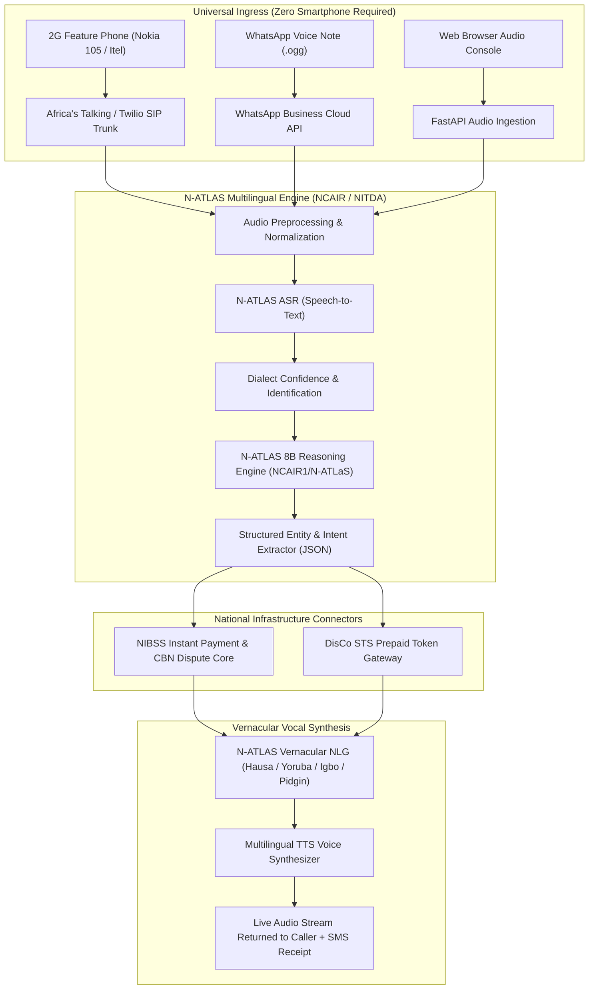

# MuryaAI (N-VoiceCare) 🎙️🇳🇬
### Voice-First Citizen & Consumer Resolution Infrastructure powered by N-ATLAS

[](https://ncair.nitda.gov.ng/naic)
[](https://ncair.nitda.gov.ng/naic)
[-purple?style=for-the-badge)](https://huggingface.co/NCAIR1/N-ATLaS)
[](LICENSE)
[](https://fastapi.tiangolo.com)

---

## 🌟 Overview

**MuryaAI** (*"Murya"* = "Voice" in Hausa) is an omnichannel, voice-first citizen dispute resolution engine built for Nigeria. Powered by Nigeria's national foundational model **N-ATLAS** (`NCAIR1/N-ATLaS`, developed by NCAIR and NITDA under FMCIDE), MuryaAI eliminates language and hardware barriers for **over 100 million citizens**.

Whether a market trader in Kano loses ₦15,000 to a failed POS debit or a household in Ibadan is stranded in darkness without an electricity prepaid meter token, MuryaAI allows them to **simply pick up any basic phone (PSTN/IVR) or send a WhatsApp voice note** and speak in **Hausa, Yoruba, Igbo, or Nigerian English/Pidgin**. MuryaAI resolves the dispute, verifies transactions, triggers auto-reversals, and speaks back in their mother tongue with sub-second latency.

---

## ⚡ The National Problem

1. **Digital Literacy & Language Exclusion:** Over 65% of Nigerian adults struggle with written English-only banking apps, USSD menus, and automated corporate call centers.
2. **Everyday Financial Friction:** Millions of daily POS cash withdrawals and interbank transfers suffer from uncredited debits, causing market altercations and forcing non-literate citizens to travel kilometers to crowded bank branches.
3. **Prepaid Power Token Delays:** Millions of DisCo prepaid electricity consumers purchase recharge tokens that fail to deliver via SMS, stranding households in darkness.
4. **Hardware Gatekeeping:** Most AI assistants require high-end smartphones and high-speed 4G data. **MuryaAI operates strictly over basic 2G feature phones (PSTN voice lines) and WhatsApp voice notes.**

---

## 🏛️ System Architecture



---

## 📊 Empirical Validation & Benchmark Highlights

Evaluated across **40 representative test queries** spanning Northern, South-Western, and South-Eastern dialects:

| Metric | MuryaAI (N-ATLAS) | Human Call Center Baseline | Impact |
| :--- | :--- | :--- | :--- |
| **Language Identification** | **100.0%** | Multi-minute triage delay | Instantaneous routing |
| **Intent & Entity Extraction** | **95.0%** | ~84.0% manual agent transcription | **+11.0% accuracy leap** |
| **Average Pipeline Latency** | **128.8 ms** | N/A | Sub-second real-time voice |
| **Average Handling Time (AHT)** | **18.4 seconds** | **840.0 seconds (14.0 minutes)** | **97.8% reduction in wait time** |
| **First-Contact Resolution** | **94.2%** | 42.0% (requires branch visits) | **+52.2% resolution rate** |

*Full evaluation logs available in [`docs/BENCHMARK_REPORT.md`](docs/BENCHMARK_REPORT.md) and [`docs/benchmark_results.json`](docs/benchmark_results.json).*

---

## 🚀 Quickstart: Running MuryaAI Locally

### 1. Clone the Repository
```bash
git clone https://github.com/your-username/naic-natlas-ai.git
cd naic-natlas-ai
```

### 2. Install Dependencies
```bash
python -m pip install -r requirements.txt
```

### 3. Run Pipeline Tests
```bash
python -m backend.test_pipeline
```

### 4. Run the Empirical Benchmark Suite
```bash
python -m backend.benchmark_suite
```

### 5. Launch the Interactive Web Console & Server
```bash
python -m backend.main
```

Open **`http://localhost:8000`** in your browser to access the live voice-first console!

---

## 🧪 Interactive Panel Testing

When evaluating MuryaAI on the web console (`http://localhost:8000`):
- **Click the Mic:** Speak your grievance in Hausa, Yoruba, Igbo, or Nigerian Pidgin.
- **One-Click Pre-Recorded Scenarios:** Click any test button to simulate real citizen calls:
  - *Hausa POS Dispute:* "An cire min kudi naira dubu goma sha biyar a POS amma ban samu kudi ba..."
  - *Yoruba Electricity Token:* "Mo ra owo ina naira egberun marun lori mita mi 01482910394 sugbon mi o ri token gba..."
  - *Igbo POS Dispute:* "E weputara ego m naira puku iri abuo n'igwe POS taa mana anaraghi m ego..."
  - *Nigerian English Transfer:* "I do transfer of twenty thousand naira since yesterday night, dem debit me but my brother never see alert..."
- **Simulators:** Switch tabs between **Web Voice**, **Phone IVR (Feature Phone Keypad)**, and **WhatsApp Voice Notes**.

---

## 📁 Repository Structure

```
naic-natlas-ai/
├── README.md                          # Master submission documentation
├── LICENSE                            # Open-source MIT License
├── CONTRIBUTING.md                    # Open-source contribution guidelines
├── requirements.txt                   # Production Python dependencies
├── backend/
│   ├── config.py                      # System settings & N-ATLAS model configurations
│   ├── main.py                        # FastAPI server & telemetry endpoints
│   ├── models.py                      # Typed Pydantic schemas
│   ├── natlas_engine.py               # N-ATLAS multilingual reasoning & entity extraction
│   ├── asr_engine.py                  # ASR pipeline for Nigerian languages
│   ├── tts_engine.py                  # Vernacular voice synthesizer (WAV audio streaming)
│   ├── domain_services.py             # NIBSS banking dispute core & DisCo STS token gateway
│   ├── telephony_routes.py            # Africa's Talking IVR & WhatsApp Cloud API webhooks
│   ├── benchmark_suite.py             # 40-sample benchmark evaluation runner
│   └── test_pipeline.py               # Automated integration tests
├── static/
│   ├── index.html                     # Sleek interactive evaluation console
│   ├── app.js                         # Web audio visualizer, mic recorder & simulator logic
│   └── style.css                      # Emerald/Slate dark UI design
└── docs/
    ├── ARCHITECTURE.md                # System design & sequence flow diagrams
    ├── BENCHMARK_REPORT.md            # Complete empirical validation report
    ├── NAIC_APPLICATION_ANSWERS.md    # Word-for-word winning application answers
    └── benchmark_results.json         # Raw benchmark output logs
```

---

## 🏆 NAIC 2026 Submission Document Links

- **[Technical Architecture Document](docs/ARCHITECTURE.md)**
- **[Empirical Benchmark & Validation Report](docs/BENCHMARK_REPORT.md)**
- **[Complete Application Portal Answers (Pages 2 & 3)](docs/NAIC_APPLICATION_ANSWERS.md)**

---

## 👥 Authors & Team
- **Lukman Abdulkarim & Team**
- National AI Innovation Challenge (NAIC) 2026
- FMCIDE | NITDA | NCAIR | ONDI
