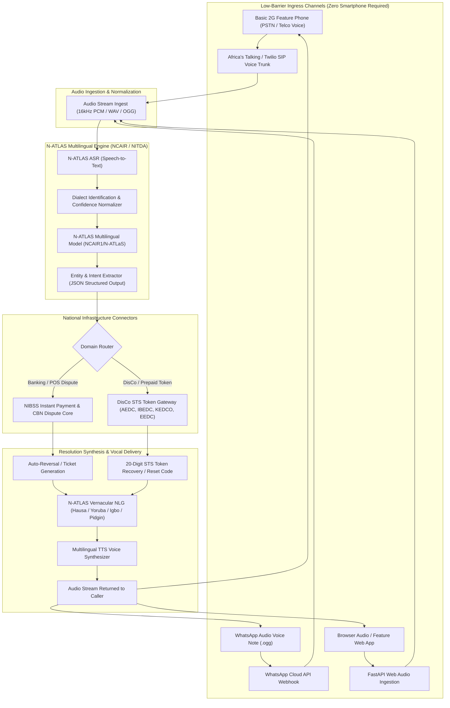
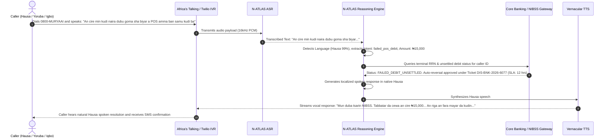
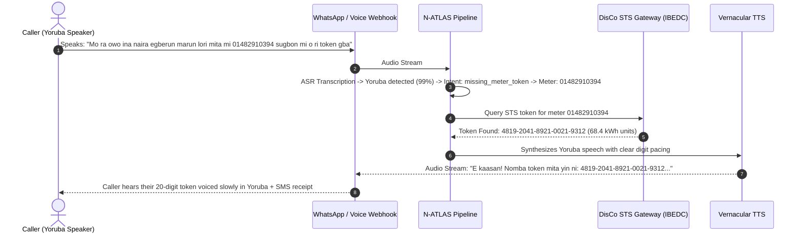

# MuryaAI System Architecture & N-ATLAS Integration

**Project Name:** MuryaAI (N-VoiceCare)  
**Track:** National AI Innovation Challenge (NAIC) 2026 – Innovation & Enterprise Track  
**Problem Statement:** PS2: Voice-First Access  
**Foundational Model:** N-ATLAS (`NCAIR1/N-ATLaS`, Llama-3 8B Multilingual Nigerian LLM + ASR)  

---

## 1. Executive Summary

MuryaAI is an omnichannel, voice-first citizen resolution infrastructure engineered to eliminate the severe language and digital literacy barrier for over 100 million Nigerians. By interfacing with **N-ATLAS** (Nigeria's foundational multilingual language model), MuryaAI allows ordinary citizens—ranging from market traders in Kano and Onitsha to rural artisans in Oyo—to resolve **failed POS banking transactions** and **missing electricity prepaid meter tokens** by simply speaking in **Hausa, Yoruba, Igbo, or Nigerian English/Pidgin** over standard 2G phone calls (IVR) or WhatsApp voice notes.

---

## 2. End-to-End System Architecture

---

## 3. Strict Compliance with PS2 Delivery Channel Mandate

> **Evaluation Requirement:** *"Delivery channel must not require a high-end smartphone or laptop."*

MuryaAI directly satisfies this requirement across two primary public-facing channels:
1. **Interactive Voice Response (IVR) via PSTN / 2G Telephony Trunks:**
   - A citizen dials a dedicated local hotline (e.g. `0800-MURYAAI` or a standard MTN/Airtel/Glo number).
   - Operable on basic feature phones (Nokia 105, Itel, Tecno button phones).
   - Audio is streamed in real-time through SIP trunks powered by Africa's Talking / Twilio voice webhooks.
2. **WhatsApp Voice Notes:**
   - WhatsApp is the default communication utility across emerging markets in Nigeria even on low-cost ₦15,000 Android devices with 3G connections.
   - The user holds the microphone icon, speaks in their mother tongue, and receives a spoken audio reply and SMS text receipt.

---

## 4. Sequence Flow: Failed POS Debit Auto-Reversal

---

## 5. Sequence Flow: DisCo Electricity Token Recovery

---

## 6. Regulatory & Security Architecture

1. **Central Bank of Nigeria (CBN) Consumer Protection Framework:**
   - Adheres to CBN circulars on failed electronic payment transactions (instant reversal SLA).
   - Generates deterministic audit reference logs (`DIS-BNK-YYMMDD-XXXX`).
2. **Nigeria Data Protection Act (NDPA) 2023 Compliance:**
   - Caller phone numbers are pseudonymized in public logs.
   - Zero retention of raw biometric voiceprints beyond the active resolution session.
